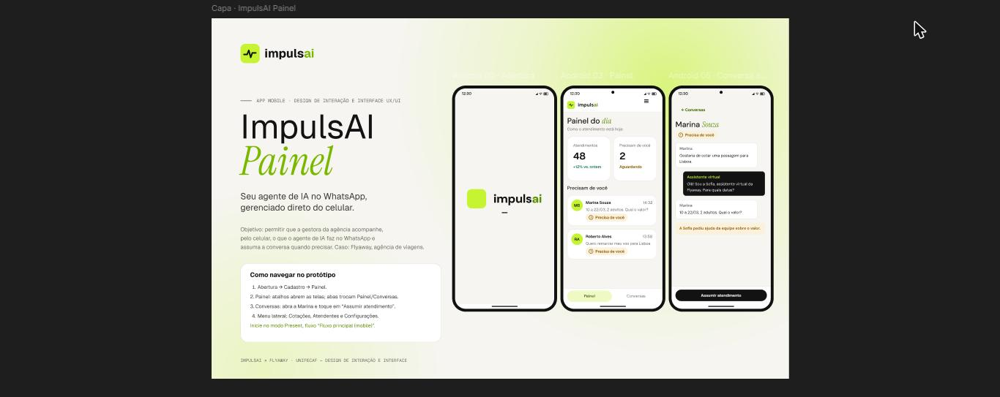

# ImpulsAI Painel — Protótipo Figma

Trabalho "Da Ideia à Experiência: Projetando e Prototipando uma Interface Digital com Figma" (Design de Interação e Interface UX/UI, UniFECAF).

**Protótipo no Figma (visualização pública):** https://www.figma.com/design/e8C2yGBij5HKxwgCQeZPKV/ImpulsAI-Painel?node-id=0-1

## Objetivo do produto

O ImpulsAI Painel é o app do agente de IA ImpulsAI, que atende clientes no WhatsApp. Nele, a dona de uma agência de viagens acompanha e controla o que o agente está fazendo, direto do celular. Ela vê as conversas, assume um atendimento quando quiser e devolve ao agente depois. As atendentes acompanham as conversas pelo computador, na versão web.

A Flyaway, agência de viagens boutique, é a empresa que testa o app e já usa o agente ImpulsAI no atendimento: a assistente virtual Sofia recebe o pedido de cotação, coleta rota, datas, passageiros e bagagem e passa o atendimento para uma consultora.

O desafio de UX é fazer uma usuária sem perfil técnico entender o que o agente está fazendo e confiar no que ele diz em seu nome.

Implementação feita pela equipe ImpulsAI: a configuração do agente e a conexão com o WhatsApp acontecem na implementação, fora do app. Por isso o app não tem telas de configuração do agente nem de conexão do WhatsApp e se concentra em acompanhar o atendimento.

## Fluxo principal

**1. Cadastro:** conta criada com o mínimo de campos.

**2. Painel:** resumo do dia, com atendimentos, pedidos de cotação e conversas que precisam da equipe.

**3. Conversas:** lista com etiqueta de status (Agente atendendo, Precisa de você, Resolvida).

**4. Conversa aberta:** leitura do que o agente disse e botão Assumir atendimento.

**5. Conversa assumida:** responder ao cliente (Enviar) ou Devolver ao agente.

O protótipo tem 13 telas mobile, em moldura de celular Android (412 px), que são a entrega principal, e uma versão web complementar com 7 telas (1440 px: painel, conversas, cotações, atendentes, conta administrativa, configurações e suporte), com o painel igual ao do app. As interações funcionam nas duas versões: o menu e os atalhos do Painel levam a cada tela, uma conversa abre ao toque, Assumir atendimento e Devolver ao agente trocam o estado, e o botão Voltar retorna à lista. Para navegar, abra o protótipo em modo apresentação e escolha o fluxo "App mobile (começa na abertura)" ou "Versão web".

## Decisões de design

**Mobile-first:** a dona da agência acompanha o agente pelo app, no celular; as atendentes acompanham as conversas pelo computador, na versão web, que adapta as telas principais.

**Uma ação principal por tela,** fixa na base e ao alcance do polegar (Lei de Hick).

**Barra de abas inferior** com Painel e Conversas, padrão conhecido (Lei de Jakob).

**Controle da usuária:** Assumir atendimento sempre visível e Devolver ao agente depois.

**Identidade ImpulsAI:** fundo off-white #F6F5F1, texto #121212, verde-limão #C6F432 só como cor de energia (nunca como texto sobre fundo claro), Geist, Instrument Serif itálico e Geist Mono.

**Acessibilidade:** meta WCAG AA e status sempre com ícone e texto.

## Limitações conhecidas

O foco do trabalho é a interface do painel; as conversas e os números exibidos são exemplos. Na lista de Conversas do mobile, só a conversa da Marina tem tela de detalhe; as demais são ilustrativas. A versão web é complementar: tem apenas Painel e Conversas, e os itens Cotações e Configurações do menu lateral não têm tela.
